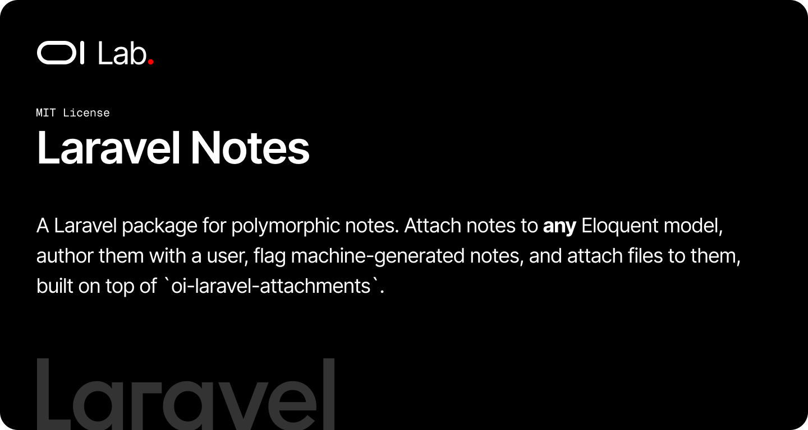

# OI Laravel Drive

[](https://packagist.org/packages/oi-lab/oi-laravel-drive)
[](https://packagist.org/packages/oi-lab/oi-laravel-drive)
[](https://github.com/oi-lab/oi-laravel-drive/actions)
[](LICENSE)

A file space with folders for any entity of your Laravel application — a Team, an Organization, a Project. Drives reuse the folders and files of [oi-laravel-attachments](https://github.com/oi-lab/oi-laravel-attachments), add the entity they belong to, an owner and a date of creation to every item, a trash, a JSON API, MCP tools for AI assistants and events to build search indexing on.

## Features

- **Drives per entity** — one drive per entity, or several named drives (config)
- **Folders** — a tree, optional unique names per parent folder
- **Files in several folders** — a file filed in no folder is at the root
- **Owner and date** — every folder and file has an owner (a user) and a settable date of creation
- **Trash** — deletions go to the trash, restorable; optional purge after X days
- **Folder deletion** — optionally with the files filed only in the deleted tree; shared files are only taken out
- **JSON API** — ready-made routes, or switch them off and call the services from your own controllers
- **MCP tools** — 13 tools for `laravel/mcp` servers, including one-time upload links for binaries
- **Events** — one per action, to index, notify or audit from other modules
- **Pluggable access** — a resolver for the current entity and its members, a replaceable policy

## How It Works

| Object | Table | Role |
|--------|-------|------|
| `Drive` | `drives` | The space of an entity (`driveable` morph), with an owner |
| `DriveEntry` | `drive_entries` | The place of a folder or file in a drive: owner, date, trash marker |
| `Folder` / `File` | `folders` / `files` | The models of oi-laravel-attachments, unchanged |
| `Attachment` | `attachments` | Files a file in a folder (collection `drive`) |
| `DriveUpload` | `drive_uploads` | An upload link opened by an assistant |

The drive adds `driveEntry`, `driveFolders` and `driveFiles` relations to the attachments models at runtime, so your own `Folder`/`File` subclasses keep working. Public identifiers are UUIDs.

## Requirements

- PHP 8.2+
- Laravel 11, 12, or 13
- `oi-lab/oi-laravel-attachments` ^1.0, `spatie/laravel-data` ^4.23
- `laravel/mcp` ^0.9 or ^1.0 for the MCP tools (optional)

## Installation

```bash
composer require oi-lab/oi-laravel-drive
```

### Publish & Migrate

```bash
php artisan vendor:publish --tag=oi-laravel-drive-config
php artisan migrate
```

## Configuration

```php
return [
    'user_model' => 'App\Models\User',

    // Which entity the user works in, and who belongs to an entity
    'driveable' => [
        'resolver' => ConfigurableDriveableResolver::class,
        'current' => 'currentTeam',     // relation or attribute of the user
        'members' => 'users',           // relation of the entity
        'current_only' => true,         // only the drives of the current entity
    ],

    'drives' => ['multiple' => false, 'default_name' => 'Documents'],
    'folders' => ['unique_names' => false],
    'files' => ['disk' => env('OI_DRIVE_DISK', ...), 'max_bytes' => 50 * 1024 * 1024, 'allowed_mimes' => null],
    'trash' => ['enabled' => true, 'purge_after_days' => env('OI_DRIVE_TRASH_PURGE_DAYS')],

    'api' => ['enabled' => true, 'prefix' => 'api/drive', 'middleware' => ['api', 'auth:sanctum']],
    'uploads' => ['enabled' => true, 'ttl_minutes' => 10, 'inline_max_bytes' => 1024 * 1024],
    'mcp' => ['naming' => 'kebab'], // or 'snake'
];
```

For other access rules, bind your own `DriveableResolver` class in `driveable.resolver`, or extend `DrivePolicy` and set it in `policy`.

## Usage

### Drives

```php
use OiLab\OiLaravelDrive\Services\DriveManager;

$drives = app(DriveManager::class);

$drive = $drives->driveFor($team);                 // default drive, created on first use
$drive = $drives->resolveDrive($user);             // default drive of the user's current entity
$archives = $drives->createDrive($team, 'Archives'); // when drives.multiple is on
```

### Folders

```php
use OiLab\OiLaravelDrive\Services\DriveFolders;

$folders = app(DriveFolders::class);

$clients = $folders->create($drive, 'Clients');
$acme = $folders->create($drive, 'Acme', parent: $clients, owner: $user, createdAt: now()->subYear());

$folders->update($acme, name: 'Acme SAS');
$folders->move($acme, null);                       // to the root
$folders->delete($clients, withFiles: true);       // to the trash, with its exclusive files
$folders->restore($clients);                       // with everything trashed with it
```

### Files

```php
use OiLab\OiLaravelDrive\Services\DriveFiles;

$files = app(DriveFiles::class);

$file = $files->store($drive, $request->file('file'), folders: [$acme, $contracts], title: 'Contract');
$note = $files->storeContent($drive, "# Minutes\n…", 'minutes.md');

$files->attach($file, [$archive]);                 // file it in one more folder
$files->detach($file, [$acme]);                    // take it out of one
$files->sync($file, []);                           // back to the root
$files->delete($file);                             // from every folder, to the trash

['url' => $url] = $files->downloadUrl($file);      // temporary link
$text = $files->text($note);                       // ['text' => …, 'truncated' => false]
```

### Listings, search, trash, owners

```php
$listing = $drives->contents($drive, $acme);       // DriveListingData: folders, files, breadcrumbs
$found = $drives->search($drive, 'invoice');       // DriveItemsData
$trash = $drives->trash($drive);
$drives->emptyTrash($drive);

$drives->setOwner($file, $colleague);
$drives->setCreatedAt($file, Carbon::parse('2020-01-01'));
```

## JSON API

With `api.enabled`, under `api.prefix` (identifiers are UUIDs, `drive` is optional and defaults to the current entity's drive):

| Method | URI | Action |
|--------|-----|--------|
| GET | `drives` | Drives of the current entity |
| POST/PATCH/DELETE | `drives`, `drives/{drive}` | Manage drives (multiple mode) |
| GET | `contents?folder=&drive=` | Content of a folder or the root |
| GET | `search?q=` | Search folders and files |
| GET/DELETE | `trash` | List or empty the trash |
| POST/GET/PATCH/DELETE | `folders`, `folders/{folder}` | Folders (`?with_files=1`, `?force=1`) |
| POST | `folders/{folder}/restore` | Restore a folder |
| POST/GET/PATCH/DELETE | `files`, `files/{file}` | Files (multipart `file`, `folder_ids[]`) |
| GET | `files/{file}/content`, `files/{file}/download` | Text + link, or redirect to the file |
| POST/DELETE | `files/{file}/folders`, `files/{file}/folders/{folder}` | File in / out of folders |

Rule violations answer `422` (or `409`) with `{error, message}`. Set `api.enabled` to `false` to expose the services through your own controllers.

## MCP Tools

```php
use OiLab\OiLaravelDrive\Mcp\DriveTools;

class AppServer extends Server
{
    protected function boot(): void
    {
        $this->tools = [...DriveTools::all(), /* … */];
    }
}
```

Add `DriveTools::INSTRUCTIONS` to the server instructions. The tools: `list-drive-folder`, `search-drive`, `get-drive-file` (metadata, temporary link, text), `list-drive-trash`, `get-drive-upload-status`, `create-drive-folder`, `update-drive-folder`, `delete-drive-folder`, `request-drive-upload` (one-time signed PUT link or drag-and-drop page), `upload-drive-file` (inline text or base64), `update-drive-file`, `delete-drive-file`, `restore-drive-item`, plus `list-drives` in multiple mode.

## Events

All in `OiLab\OiLaravelDrive\Events`, with `SerializesModels` so listeners may be queued:

`DriveCreated`, `DriveUpdated`, `DriveDeleted`, `DriveFolderCreated`, `DriveFolderUpdated`, `DriveFolderMoved`, `DriveFolderTrashed`, `DriveFolderRestored`, `DriveFolderDeleted`, `DriveFileCreated`, `DriveFileUpdated`, `DriveFileTrashed`, `DriveFileRestored`, `DriveFileDeleted`, `DriveFileAttached`, `DriveFileDetached`, `DriveEntryOwnerChanged`.

Permanent deletions carry a Data snapshot (`DriveFolderData`, `DriveFileData`), the model being gone. Listen to them to feed Laravel Scout or `oi-laravel-raggable`.

## Commands

```bash
php artisan drive:purge-trash [--days=30]   # scheduled daily when trash.purge_after_days is set
php artisan drive:prune-uploads             # scheduled hourly when uploads are on
```

## AI Assistant Skills

```bash
php artisan oi:skills oilab-laravel-drive --project
```

## Testing

```bash
composer test
```

## Contributing

Contributions are welcome! Please feel free to submit a Pull Request.

When contributing:
1. Write tests for new features
2. Ensure all tests pass: `vendor/bin/pest`
3. Follow existing code style
4. Update documentation as needed

## License

The MIT License (MIT). Please see the [License File](LICENSE) for more information.

## Credits

**[Olivier Lacombe](https://www.olacombe.com)** - Creator and maintainer

Olivier is a Product & Technology Director based in Montpellier, France, with
over 20 years of experience innovating in UX/UI and emerging technologies. He
specializes in guiding enterprises toward cutting-edge digital solutions,
combining user-centered design with continuous optimization and artificial
intelligence integration.

**Projects & Resources:**
- [OI Dev Docs](https://dev.olacombe.com) - Documentation for all Open Source OI Lab packages
- [OnAI](https://onai.olacombe.com) - Training courses and masterclasses on generative AI for businesses
- [Promptr](https://promptr.olacombe.com) - Prompt engineering Management Platform

## Support

For support, please open an issue on the [GitHub repository](https://github.com/oi-lab/oi-laravel-drive/issues).
